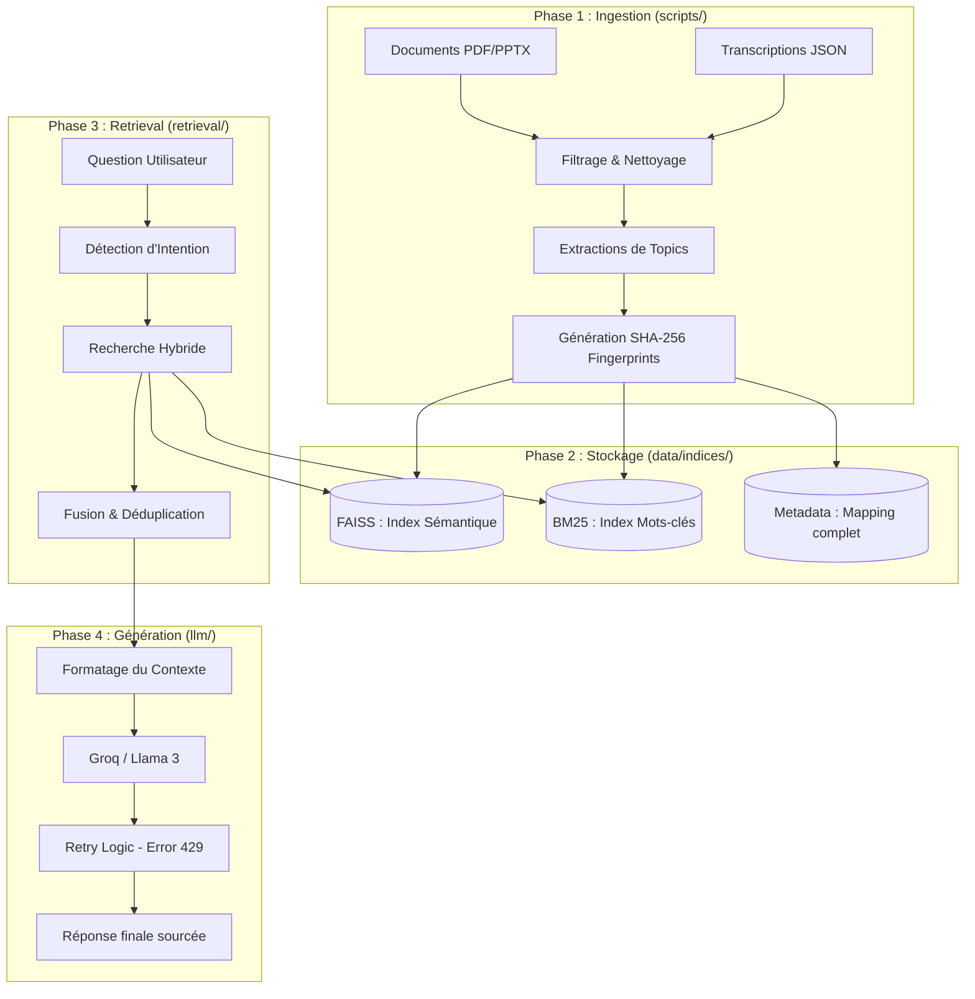
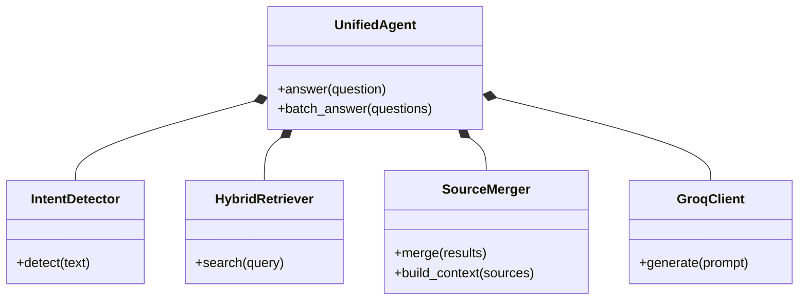

# Architecture Technique : Unified Chronotime Agent

Ce document présente l'architecture "A à Z" du système RAG (Retrieval-Augmented Generation) unifié, tel qu'il est implémenté dans le dossier `unified-agent`.

## 1. Vue d'Ensemble du Flux de Données

Le système suit une architecture en pipeline, de la donnée brute jusqu'à la réponse générée par l'IA.

## 2. Composants Clés

### 2.1 Moteur de Recherche Hybride (`HybridRetriever`)
Le système ne se contente pas d'une recherche par "sens" (sémantique). Il combine deux mondes :
- **FAISS** : Compréhension sémantique (vecteurs de 384 dimensions).
- **BM25** : Précision lexicale (recherche par mots-clés exacts).
*Avantage : Meilleure précision sur les termes techniques de Chronotime.*

### 2.2 Déduplication Intelligente (`SourceMerger`)
Pour éviter que l'IA ne lise plusieurs fois la même information, le système utilise des **SHA-256 Fingerprints**. Chaque bloc de texte a une empreinte unique. Si une information est présente dans deux fichiers différents, elle est fusionnée.

### 2.3 Robustesse API (`GroqClient`)
L'intégration avec Groq inclut une logique de **Retry avec Backoff Exponentiel**. Si l'API est saturée (Erreur 429), le système attend quelques secondes avant de retenter, garantissant une continuité de service.

## 3. Schéma de l'Infrastucture Logicielle

