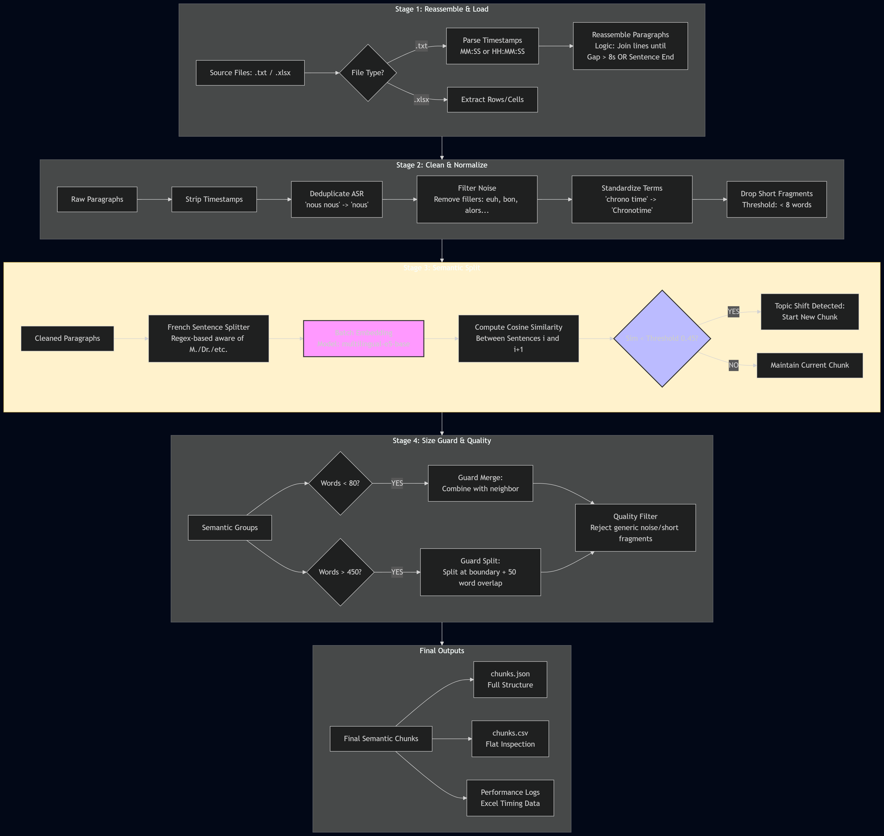
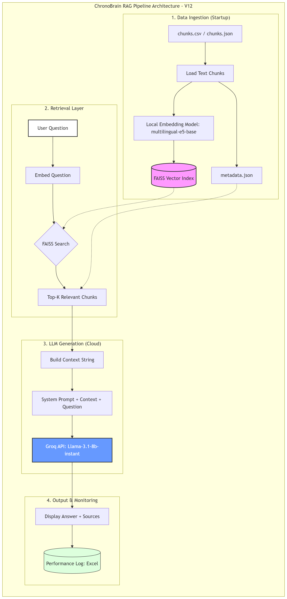

## Data engineer Thinking in the code architechture
-  "Partial Failures" (échecs partiels). Si ton script s'est arrêté brusquement (comme ton erreur Code -9 de tout à l'heure), il a pu créer un fichier .txt mais ne rien écrire dedans.

# test questions:
q = "À quoi sert le matricule alpha et dans quels cas est-il utilisé ?"
q = "Quelle est la différence entre un programme hebdomadaire et un cycle ?
q = "Que se passe-t-il lorsqu’un collaborateur badge en dehors de sa plage horaire ?"
q = "Comment les heures supplémentaires sont‑elles calculées ?"
q = "Comment créer client principal ?"
q = "c'est quoi la difference entre astreinte et heures supplémentaire?"
q = "eeeeeeeeeeeeeeeee"
q = "comment fonctionnent asreinte realisees et astreinte prevue ?"
q = "comment creer un profile utilisateur?"    

# Architectures of versions
- Version V11:

- Version V12:
