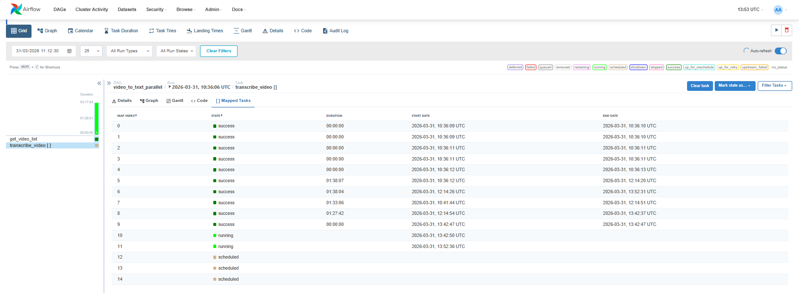

# Running the Airflow Video Transcription Pipeline

## Build the Docker Image

```bash
docker-compose build
```

## Start Airflow

```bash
docker-compose up
```

```bash 
docker-compose build --no-cache
```
```bash
docker-compose down --rmi all --volumes --remove-orphans
docker-compose down --volumes --remove-orphans
```
## Access Airflow

Open your browser and go to:

    http://localhost:8080

The login details (username= *****, passwoed= *****) will appear in your terminal  


## Place Your Videos

Put your 2‑hour videos in this folder on Windows:

    ChronoBrain/data/raw_videos/

## Trigger the DAG

In the Airflow UI:

1.  Find `video_to_text_pipeline`
2.  Turn it **On**
3.  Click the **Play ▶️** button

## What Happens Next

*   Airflow starts the task.
*   Python parallelism inside the task launches **2 workers**.
*   Your CPU will spike to **100%** during transcription.
*   `.txt` transcript files will appear in:

<!---->

    data/transcripts/

## Why This Architecture Works Well

*   **Separation:** You always keep the generated `.txt` files.
*   **Next Task:** You can add a second Airflow task (`task_embed`) to insert transcripts into ChromaDB.
*   **Reliability:**  
    If embedding fails, you **do not lose the transcription**.  
    Fix the code → Click **Retry** in Airflow.

## The airflow UI
