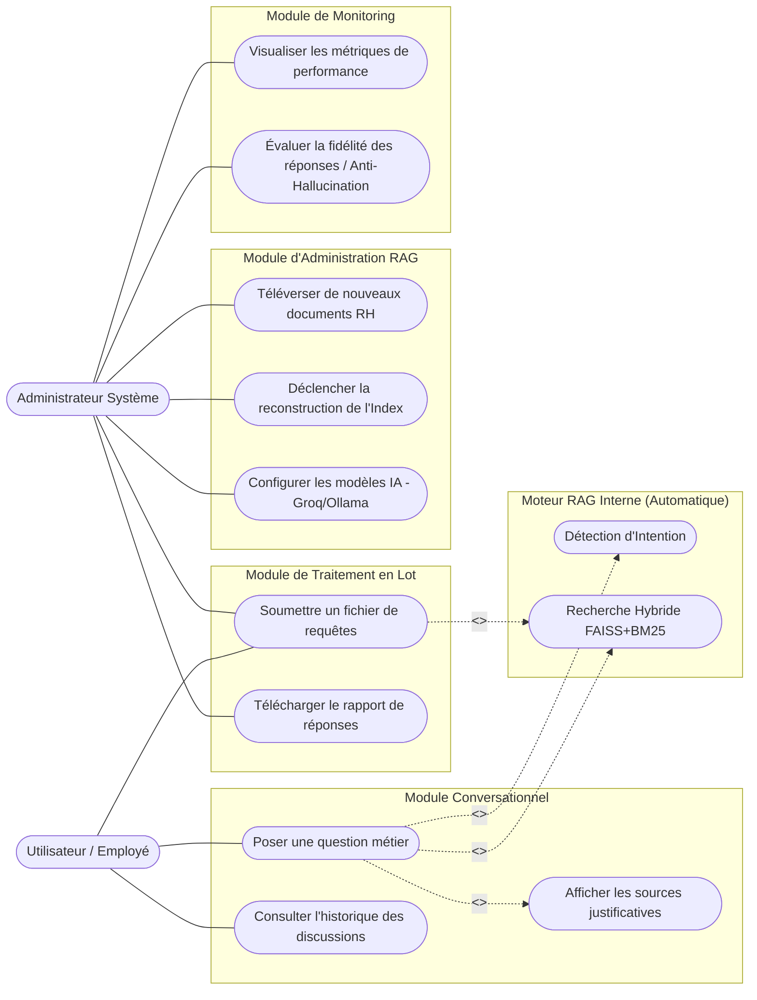
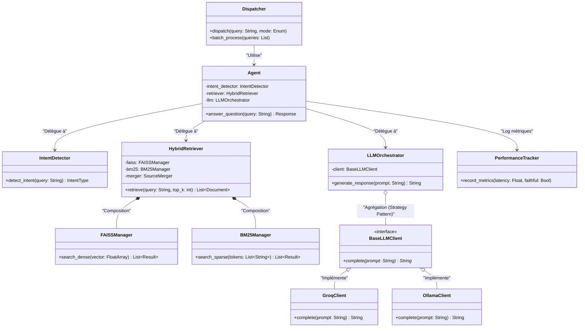
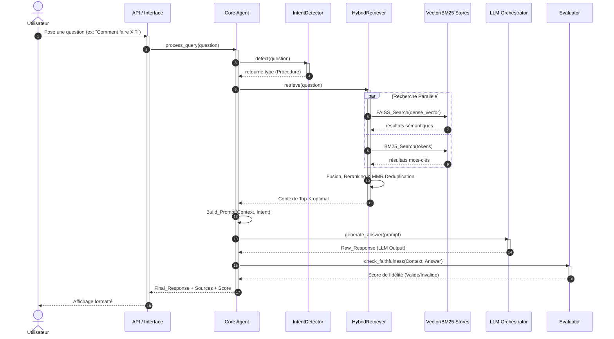

# 📐 Diagrammes UML du Système (Agent RAG Unifié)

Ces diagrammes (Cas d'Utilisation, Classes et Séquence) modélisent le système sous l'angle de l'ingénierie logicielle (UML). Ils sont idéaux pour illustrer la conception orientée objet et les interactions dynamiques lors de votre soutenance.

---

## 1️⃣ Diagramme de Cas d'Utilisation (Use Case Diagram)

---

## 2️⃣ Diagramme de Classes (Class Diagram)
Ce diagramme met en évidence l'architecture orientée objet du composant `unified-agent`, le respect des principes **SOLID** et l'utilisation des Design Patterns (Factory, Strategy).

---

## 3️⃣ Diagramme de Séquence (Sequence Diagram)
Ce diagramme modélise le flux d'exécution temporel complexe lorsqu'un utilisateur pose une question. Il met en évidence le parallélisme et la logique conditionnelle du pipeline RAG Hybride.

### 💡 Points Forts à souligner à l'oral
- **Séparation des préoccupations (Class Diagram)** : Montrez comment le "Strategy Pattern" utilisé pour le LLM (`BaseLLMClient`, `GroqClient`, `OllamaClient`) permet de changer d'Intelligence Artificielle en une ligne de code sans toucher à la logique métier.
- **RAG Hybride Parallélisé (Sequence Diagram)** : Mettez en avant le bloc "par" (parallèle) où FAISS et BM25 cherchent en même temps, maximisant la vitesse (réduction du goulot d'étranglement).
- **Évaluation Continue (Sequence Diagram)** : La dernière étape avec l'`Evaluator` prouve la robustesse du système face aux hallucinations, un argument critique dans les systèmes d'IA de production.
