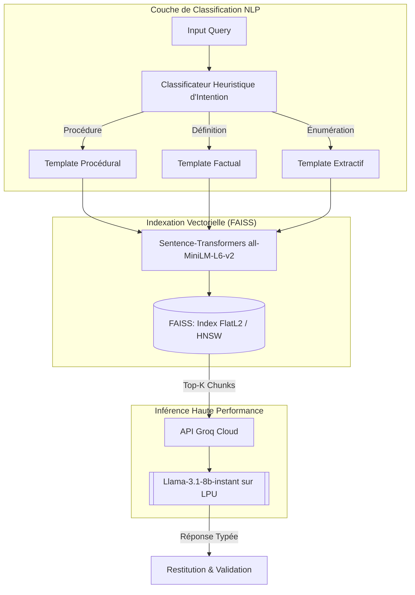
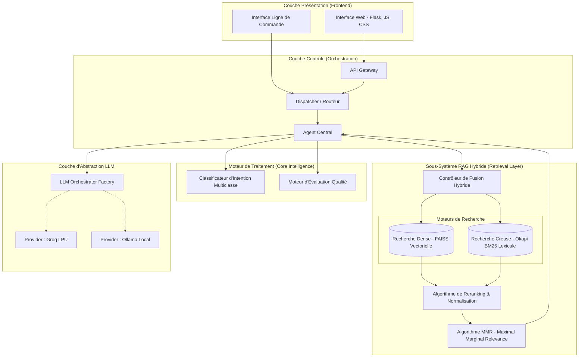

# 🎓 Architecture Scientifique & Technique (Document de Soutenance)

Ce document présente l'évolution architecturale et algorithmique du système **Agent RAG Unifié**, depuis les preuves de concept (POC) jusqu'à l'architecture de production finale. Il est rédigé avec une terminologie académique et professionnelle, idéale pour une présentation de soutenance ou un rapport de thèse.

---

## 1️⃣ Phase 1 : Preuve de Concept Locale (Projet `ChronoBrain-main`)

L'objectif de cette phase était de valider la faisabilité d'un pipeline **RAG (Retrieval-Augmented Generation)** opérant de manière entièrement déconnectée (On-Premise), garantissant la confidentialité absolue des données.

### Diagramme d'Architecture Matérielle et Logicielle

```mermaid
graph TD
    subgraph "Couche Client & Interface"
        A[Terminal / CLI]
    end

    subgraph "Couche de Mémorisation (Caching)"
        B{SimpleCache Hashé (MD5)}
    end

    subgraph "Moteur de Recherche (Information Retrieval)"
        C[Hybrid Retriever Base]
        D[(ChromaDB - Index Dense)]
        E[(Fichier Pickle - Index Creux BM25)]
        
        C -- "Similarité Cosinus" --> D
        C -- "TF-IDF / Okapi BM25" --> E
    end

    subgraph "Modélisation LLM (Local)"
        F[[Ollama Engine]]
        G[Llama-3 Quantifié 8B]
        F --> G
    end

    subgraph "Post-Traitement NLP"
        H[Filtre Anti-Hallucination via Regex]
        I[Vérificateur de Fidélité (Faithfulness)]
        J[Moniteur de Latence]
    end

    A -->|Requête| B
    B -- Miss --> C
    C -->|Top-K Context| F
    F -->|Raw Output| H
    H --> I
    I --> J
    J --> A
```

### 🔬 Fondements Scientifiques et Limites
- **Embeddings** : Utilisation du modèle `BAAI/bge-small-en-v1.5` générant des vecteurs de haute dimension pour la recherche de similarité sémantique spatiale.
- **Limitation** : L'inférence du LLM sur CPU/GPU local génère une latence significative (goulot d'étranglement de la bande passante mémoire). Le filtrage des hallucinations s'appuie sur des heuristiques statiques (Regex) manquant de compréhension contextuelle.

---

## 2️⃣ Phase 2 : Accélération Cloud et Heuristique (Projet `DataCl`)

Pour pallier les problèmes de latence et améliorer la précision, cette itération a externalisé l'inférence via des **LPU (Language Processing Units)** tout en intégrant une couche de classification des intentions.

### Diagramme de Pipeline NLP & Inférence



### 🔬 Fondements Scientifiques
- **Indexation FAISS (Facebook AI Similarity Search)** : Implémentation d'une structure d'indexation optimisée en RAM, permettant une recherche du plus proche voisin (K-NN) algorithmiquement efficace (complexité algorithmique réduite par rapport à ChromaDB).
- **Inférence LPU** : L'utilisation de puces LPU de Groq permet une architecture déterministe qui accélère considérablement le *Time-To-First-Token* (TTFT).

---

## 3️⃣ Architecture Finale : Le Système Hybride Unifié (`unified-agent`)

L'architecture finale s'appuie sur les principes de l'ingénierie logicielle robuste (principes SOLID) et combine le meilleur de l'analyse sémantique et de la recherche statistique.

### Diagramme Systémique Complet (Système Distribué)



### 🔬 Innovations et Explications Algorithmiques pour la Soutenance

1. **Recherche Hybride par Fusion de Scores (Reciprocal Rank Fusion)** :
   Le système ne repose plus sur une seule méthode de recherche.
   - **Okapi BM25 (Sparse)** : Calcule la probabilité de pertinence par la fréquence des termes précis et acronymes techniques (ex: "SAP", "B_HS").
   - **FAISS (Dense)** : Utilise la distance cosinus entre les vecteurs d'encastrement (Embeddings) pour capter la sémantique de la question, même si les mots diffèrent.
   - Le composant `Source Merger & Reranker` normalise ces deux distributions statistiques pour obtenir un classement global optimal.

2. **Dédoublonnage MMR (Maximal Marginal Relevance)** :
   Une fois les documents récupérés, l'algorithme MMR s'assure de maximiser la *diversité* de l'information envoyée au LLM. Il pénalise les documents sémantiquement trop proches d'un document déjà sélectionné, évitant ainsi le gaspillage du "Context Window" du modèle de langage.

3. **Modèles de Conception (Design Patterns)** :
   - **Factory / Strategy Pattern** : Utilisé dans le `LLM Orchestrator` permettant d'interchanger le fournisseur d'inférence (Groq vs Ollama) sans modifier la logique métier.
   - **Architecture Décousue (Decoupled)** : La séparation stricte entre l'ingestion (`ingestion/`), le stockage (`storage/`), la récupération (`retrieval/`) et le modèle LLM (`llm/`) garantit la maintenabilité et l'évolutivité du système.

4. **Détection d'Intention Dynamique** :
   Le système parse la syntaxe de la requête utilisateur pour modifier en temps réel le *System Prompt*. Cette adaptation (Dynamic Prompting) dirige mathématiquement l'attention (Self-Attention) du LLM vers un comportement de réponse approprié (pas de longs paragraphes si une liste est attendue).
